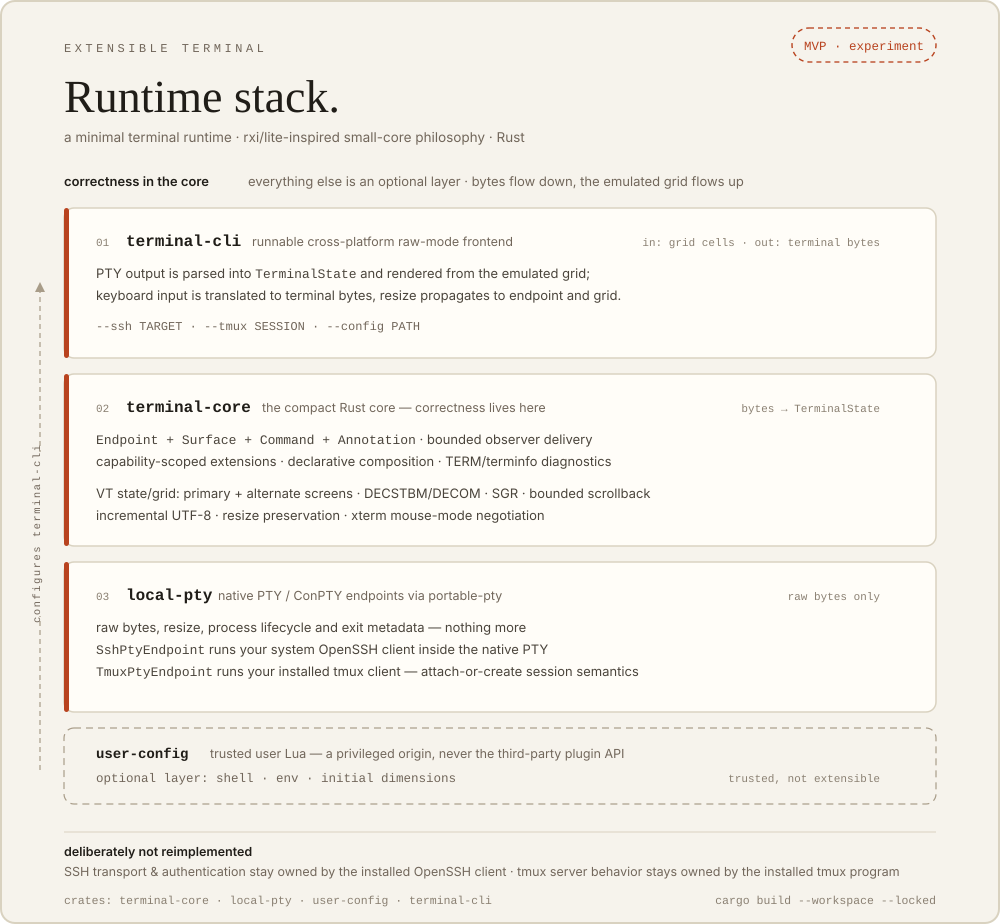

# Extensible Terminal MVP

A minimal terminal runtime inspired by rxi/lite's small-core philosophy. The implementation keeps terminal correctness in a compact Rust core and treats workspace behavior, shell semantics, and extension policy as optional layers.

<p align="center">
  
</p>

## What is implemented

- `terminal-core`: public `Endpoint + Surface + Command + Annotation` model, bounded observer delivery, capability-scoped extensions, extension lifecycle policy, declarative composition, TERM/terminfo diagnostics, transition instrumentation, and a minimal VT terminal state/grid with primary and alternate screens, cursor movement, DECSTBM scroll margins with DECOM origin-relative addressing, basic SGR, bounded scrollback, incremental UTF-8 decoding, resize preservation, and bounded xterm mouse-mode negotiation state.
- `local-pty`: native local PTY/ConPTY endpoint using `portable-pty`; raw bytes, resize, process lifecycle, and exit metadata only. It also provides `SshPtyEndpoint`, which runs the user's system OpenSSH client inside that same native PTY and reports remote SSH endpoint capabilities without implementing SSH protocol itself, and `TmuxPtyEndpoint`, which runs the user's installed tmux client with attach-or-create session semantics without implementing a multiplexer.
- `user-config`: trusted user Lua configuration for shell, terminal environment, and initial dimensions. This path is explicitly trusted and is not the third-party plugin API.
- `terminal-cli`: runnable cross-platform raw-mode frontend. PTY output is parsed into `TerminalState` and rendered from the emulated grid; keyboard input is translated to terminal bytes, negotiated SGR mouse input is forwarded only while the child requests a supported tracking mode, and resize events propagate to both the endpoint and grid. `--ssh TARGET` selects the concrete system-SSH endpoint, `--tmux SESSION` selects the concrete system-tmux endpoint, and the default path remains the configured/local shell.

Tmux server/socket/session behavior remains owned by the installed tmux program rather than being reimplemented in core. SSH transport/authentication remains owned by the installed OpenSSH client rather than by terminal core.

## Requirements

- Rust 1.85 or newer
- A C compiler when building the vendored Lua 5.4 dependency used by `user-config`
- Linux/macOS PTY support or Windows ConPTY support supplied by the host OS
- An `ssh` executable on `PATH` when using `terminal-cli --ssh`; OpenSSH configuration, credentials, agents, host-key verification, ProxyJump, algorithms, and network policy remain external to this project
- A `tmux` executable on `PATH` when using `terminal-cli --tmux`; tmux configuration, server/socket ownership, session persistence, prefix/key bindings, panes, and detach policy remain external to this project

## Build and test

The repository commits `Cargo.lock`; CI uses locked dependency resolution on Ubuntu and Windows. From the repository root:

```sh
cargo build --workspace --locked
cargo test --workspace --locked
cargo clippy --workspace --all-targets --locked -- -D warnings
```

Release build:

```sh
cargo build --workspace --release --locked
```

The resulting release executable is `target/release/terminal-cli` on Unix-like hosts and `target\release\terminal-cli.exe` on Windows.

Release-oriented validation now includes a behavior fixture that combines alternate-screen switching, DECSTBM/DECOM, DECAWM, cursor save/restore, SGR/BCE, application cursor/keypad modes, bracketed-paste negotiation, resize, high-rate output, bounded scrollback, and slow-extension backpressure. Ubuntu CI also runs the production frontend through a real `less` pager session in addition to the basic shell smoke. The pager fixture is local and deterministic; it uses no network service or user configuration.

A non-gating release metrics executable records terminal-core feed throughput plus fixed cell/grid/scrollback storage bounds without using shared-runner timing as a pass/fail threshold:

```sh
cargo run --locked --release -p terminal-core --example release_metrics
```

The frontend's deterministic damage regression separately measures a one-cell update on an 80x24 surface as 1 emitted cell versus 1,920 cells for a full redraw. These measurements are release evidence, not a universal host-latency guarantee.

## Install from source

From a clean checkout, first complete the locked release build above. Then, from the repository root, install the CLI with Cargo using the committed lockfile:

```sh
cargo install --path crates/terminal-cli --locked
```

Cargo installs the `terminal-cli` executable into its normal binary directory (by default `$CARGO_HOME/bin`, or the platform-equivalent Cargo bin directory). Ensure that directory is on `PATH`, then start a local interactive shell with:

```sh
terminal-cli
```

The installed executable supports the same `--config`, `--ssh`, `--tmux`, and `-- PROGRAM [ARGS...]` forms shown below. Configuration files are ordinary user-supplied paths and are not copied by `cargo install`; pass the desired path explicitly with `--config`.

To remove a Cargo-installed copy:

```sh
cargo uninstall terminal-cli
```

This is the reproducible source-install path. The repository does not currently claim a platform installer, OS package-manager registration, signed binary bundle, or downloadable prebuilt release artifact; those must not be inferred from the source build instructions.

## Run

Launch the platform's default shell directly from the source tree:

```sh
cargo run -p terminal-cli --locked
```

Or, after the source installation above:

```sh
terminal-cli
```

Use the included trusted Lua settings from the source tree:

```sh
cargo run -p terminal-cli --locked -- --config examples/config.lua
```

With an installed binary, pass the path to any trusted configuration file explicitly:

```sh
terminal-cli --config /path/to/config.lua
```

Run a specific program instead of the configured/default shell:

```sh
cargo run -p terminal-cli --locked -- -- echo hello
```

Installed equivalent:

```sh
terminal-cli -- echo hello
```

Open an interactive SSH terminal through the system OpenSSH client:

```sh
cargo run -p terminal-cli --locked -- --ssh user@example.com
```

Installed equivalent:

```sh
terminal-cli --ssh user@example.com
```

The SSH target is passed directly as one process argument to `ssh`; the terminal does not build a shell command string, parse authentication prompts, store credentials, or override OpenSSH host-key/configuration policy. The provider requests a remote TTY and continues to feed the resulting raw bytes through the same terminal-emulation path used for local sessions.

Attach to an existing tmux session, or create it if it does not exist:

```sh
cargo run -p terminal-cli --locked -- --tmux work
```

Installed equivalent:

```sh
terminal-cli --tmux work
```

The tmux session name is bounded and passed directly as the `-s` argument to `tmux new-session -A`. The endpoint reports local persistence because tmux sessions live in the tmux server independently of this client, but it deliberately does not advertise a programmatic detach operation or authoritative scrollback. Interactive detach remains tmux-owned and follows the user's tmux configuration; after detaching, rerunning the same `--tmux SESSION` command reattaches to that session.

The frontend enters raw mode and an alternate host screen, renders endpoint output through the terminal-core grid, forwards common character/control/navigation/function keys, tracks host resize events, and restores the host terminal when it exits. When a child enables xterm event-selection mode 1000, 1002, or 1003 together with SGR mouse encoding mode 1006, the frontend enables host mouse capture only for the negotiated interval and forwards filtered press/release/drag/move/wheel reports with 1-based coordinates. Disabling the child mode—or any frontend exit path—disables host capture again. Selection and clipboard behavior are intentionally separate future work. This is now a real terminal-emulation path rather than a PTY byte relay, but the VT implementation is intentionally incomplete; see `docs/KNOWN_LIMITATIONS.md` before treating it as a general-purpose replacement terminal.

## Trusted Lua configuration

A config file returns a Lua table. Supported fields are `shell`, `shell_args`, `term`, `colorterm`, `cols`, and `rows`. The bundled example only sets terminal environment and dimensions. For SSH and tmux sessions, `term`, `colorterm`, and the initial dimensions apply locally to the provider process; configured shell/shell arguments are not treated as remote commands or tmux pane commands.

Lua configuration is trusted user code and may use Lua standard libraries. Never load third-party extension packages through this path. Third-party extensions remain capability-scoped by `terminal-core::ExtensionPolicy` and bounded inboxes.

## Design documents

- `docs/ARCHITECTURE.md`
- `docs/SECURITY.md`
- `docs/KNOWN_LIMITATIONS.md`

---

*Built by [Hans Sai](https://builtbysai.com).*
